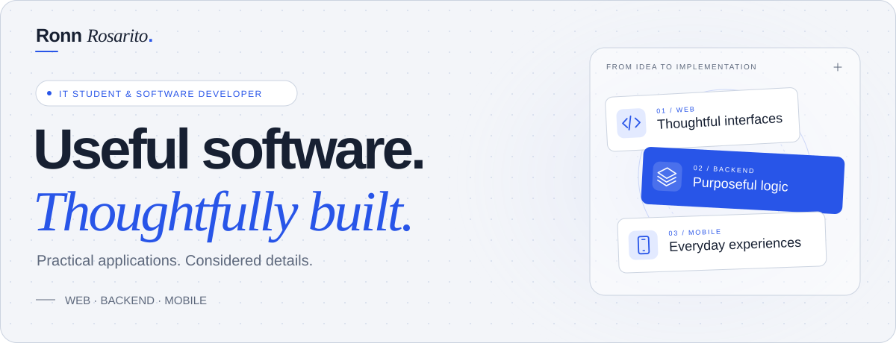

<picture>
  <source media="(prefers-color-scheme: dark)" srcset="https://raw.githubusercontent.com/PhonsekalLaure/PhonsekalLaure/main/assets/hero-dark.svg">
  <source media="(prefers-color-scheme: light)" srcset="https://raw.githubusercontent.com/PhonsekalLaure/PhonsekalLaure/main/assets/hero-light.svg">
  
</picture>

# Ronn Saimund Rosarito

**IT student & software developer · Manila, Philippines**

I build practical web and mobile applications, with a focus on the workflows and application logic behind them. I care about thoughtful interfaces, clear responsibilities, and the details that make a feature work.

[LinkedIn](https://www.linkedin.com/in/rsrosarito/) · [Email](mailto:rosaritoronnsaimund@gmail.com)

## 01 / Selected work

### PRISM-GUARD

**Web & mobile · Collaborative academic capstone**

Connecting agency administration, client operations, and guard-facing workflows across web and mobile.

I served as **project manager, database administrator, and lead developer, focusing on backend development**. My contributions include payroll review, mobile earnings, client management, deployment permissions, and attendance evidence workflows.

`React` `React Native` `Expo` `Express` `Supabase`

[Web repository](https://github.com/PhonsekalLaure/prism-guard-web) · [Mobile repository](https://github.com/PhonsekalLaure/prism-guard-mobile) · [Promotional repository](https://github.com/PhonsekalLaure/prism-guard-promo)

### Frighton University SIS

**Web application · Collaborative academic project · In development**

Student information workflows with separate responsibilities for student records and administrative account management.

I contributed **student portal APIs, admin account workflows, and database migrations**, including authentication, account lifecycle actions, and administrative audit logs.

`TypeScript` `React` `Express` `Supabase` `PostgreSQL`

[Repository](https://github.com/PhonsekalLaure/frighton-university-sis)

### ITSO Equipment Management

**Web application · Equipment management**

Equipment availability from reservation through borrowing and returns.

I implemented **inventory and borrow tracking, reservation soft deletion, and status filtering**, keeping reservation state aligned with equipment availability.

`PHP` `CodeIgniter` `JavaScript`

[Repository](https://github.com/PhonsekalLaure/itso) · [Interface contribution](https://github.com/PhonsekalLaure/itso/pull/7)

## 02 / My toolkit

| Area | Tools & technologies |
| :--- | :--- |
| Frontend | HTML · CSS · JavaScript · TypeScript · React |
| Backend & data | Node.js · Express · PHP · CodeIgniter · PostgreSQL · MySQL · Supabase · Firebase |
| Mobile | React Native · Kotlin · Swift |
| Tools & workflow | Git · GitHub · Docker · Composer · Figma · Software testing · Technical documentation |
| Additional languages | Python · Java · C++ |

## 03 / How I work

- **Start with the workflow.** Understand the people and the process before deciding what to build.
- **Build with intention.** Give interfaces, access rules, and error states the same consideration.
- **Keep learning in public.** Use Git, pull requests, and code review to make the next iteration better.

I’m studying **BS Information Technology, specializing in Web and Mobile Applications**, at **FEU Institute of Technology**.

---

*Learning through building. Growing through collaboration.*
