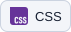
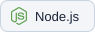
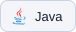

<picture>
  <source media="(prefers-color-scheme: dark)" srcset="https://raw.githubusercontent.com/PhonsekalLaure/PhonsekalLaure/main/assets/hero-dark.svg">
  <source media="(prefers-color-scheme: light)" srcset="https://raw.githubusercontent.com/PhonsekalLaure/PhonsekalLaure/main/assets/hero-light.svg">
  
</picture>

# Ronn Saimund Rosarito

**IT student & software developer · Manila, Philippines**

I build practical web and mobile applications, with a focus on the workflows and application logic behind them. I care about thoughtful interfaces, clear responsibilities, and the details that make a feature work.

[LinkedIn](https://www.linkedin.com/in/rsrosarito/) · [Email](mailto:rosaritoronnsaimund@gmail.com)

## 01 / Selected work

### PRISM-GUARD

**Web & mobile · Collaborative academic capstone**

Connecting agency administration, client operations, and guard-facing workflows across web and mobile.

I served as **project manager, database administrator, and lead developer, focusing on backend development**. My contributions include payroll review, mobile earnings, client management, deployment permissions, and attendance evidence workflows.

<picture><source media="(prefers-color-scheme: dark)" srcset="https://raw.githubusercontent.com/PhonsekalLaure/PhonsekalLaure/main/assets/stack/react-dark.svg"></picture> <picture><source media="(prefers-color-scheme: dark)" srcset="https://raw.githubusercontent.com/PhonsekalLaure/PhonsekalLaure/main/assets/stack/react-native-dark.svg"></picture> <picture><source media="(prefers-color-scheme: dark)" srcset="https://raw.githubusercontent.com/PhonsekalLaure/PhonsekalLaure/main/assets/stack/expo-dark.svg"></picture> <picture><source media="(prefers-color-scheme: dark)" srcset="https://raw.githubusercontent.com/PhonsekalLaure/PhonsekalLaure/main/assets/stack/express-dark.svg"></picture> <picture><source media="(prefers-color-scheme: dark)" srcset="https://raw.githubusercontent.com/PhonsekalLaure/PhonsekalLaure/main/assets/stack/supabase-dark.svg"></picture>

[Web repository](https://github.com/PhonsekalLaure/prism-guard-web) · [Mobile repository](https://github.com/PhonsekalLaure/prism-guard-mobile) · [Promotional repository](https://github.com/PhonsekalLaure/prism-guard-promo)

### Frighton University SIS

**Web application · Collaborative academic project · In development**

Student information workflows with separate responsibilities for student records and administrative account management.

I contributed **student portal APIs, admin account workflows, and database migrations**, including authentication, account lifecycle actions, and administrative audit logs.

<picture><source media="(prefers-color-scheme: dark)" srcset="https://raw.githubusercontent.com/PhonsekalLaure/PhonsekalLaure/main/assets/stack/typescript-dark.svg"></picture> <picture><source media="(prefers-color-scheme: dark)" srcset="https://raw.githubusercontent.com/PhonsekalLaure/PhonsekalLaure/main/assets/stack/react-dark.svg"></picture> <picture><source media="(prefers-color-scheme: dark)" srcset="https://raw.githubusercontent.com/PhonsekalLaure/PhonsekalLaure/main/assets/stack/express-dark.svg"></picture> <picture><source media="(prefers-color-scheme: dark)" srcset="https://raw.githubusercontent.com/PhonsekalLaure/PhonsekalLaure/main/assets/stack/supabase-dark.svg"></picture> <picture><source media="(prefers-color-scheme: dark)" srcset="https://raw.githubusercontent.com/PhonsekalLaure/PhonsekalLaure/main/assets/stack/postgresql-dark.svg"></picture>

[Repository](https://github.com/PhonsekalLaure/frighton-university-sis)

### ITSO Equipment Management

**Web application · Equipment management**

Equipment availability from reservation through borrowing and returns.

I implemented **inventory and borrow tracking, reservation soft deletion, and status filtering**, keeping reservation state aligned with equipment availability.

<picture><source media="(prefers-color-scheme: dark)" srcset="https://raw.githubusercontent.com/PhonsekalLaure/PhonsekalLaure/main/assets/stack/php-dark.svg"></picture> <picture><source media="(prefers-color-scheme: dark)" srcset="https://raw.githubusercontent.com/PhonsekalLaure/PhonsekalLaure/main/assets/stack/codeigniter-dark.svg"></picture> <picture><source media="(prefers-color-scheme: dark)" srcset="https://raw.githubusercontent.com/PhonsekalLaure/PhonsekalLaure/main/assets/stack/javascript-dark.svg"></picture>

[Repository](https://github.com/PhonsekalLaure/itso) · [Interface contribution](https://github.com/PhonsekalLaure/itso/pull/7)

## 02 / My toolkit

### Frontend

<picture><source media="(prefers-color-scheme: dark)" srcset="https://raw.githubusercontent.com/PhonsekalLaure/PhonsekalLaure/main/assets/stack/html-dark.svg"></picture> <picture><source media="(prefers-color-scheme: dark)" srcset="https://raw.githubusercontent.com/PhonsekalLaure/PhonsekalLaure/main/assets/stack/css-dark.svg"></picture> <picture><source media="(prefers-color-scheme: dark)" srcset="https://raw.githubusercontent.com/PhonsekalLaure/PhonsekalLaure/main/assets/stack/javascript-dark.svg"></picture> <picture><source media="(prefers-color-scheme: dark)" srcset="https://raw.githubusercontent.com/PhonsekalLaure/PhonsekalLaure/main/assets/stack/typescript-dark.svg"></picture> <picture><source media="(prefers-color-scheme: dark)" srcset="https://raw.githubusercontent.com/PhonsekalLaure/PhonsekalLaure/main/assets/stack/react-dark.svg"></picture>

### Backend & data

<picture><source media="(prefers-color-scheme: dark)" srcset="https://raw.githubusercontent.com/PhonsekalLaure/PhonsekalLaure/main/assets/stack/node-js-dark.svg"></picture> <picture><source media="(prefers-color-scheme: dark)" srcset="https://raw.githubusercontent.com/PhonsekalLaure/PhonsekalLaure/main/assets/stack/express-dark.svg"></picture> <picture><source media="(prefers-color-scheme: dark)" srcset="https://raw.githubusercontent.com/PhonsekalLaure/PhonsekalLaure/main/assets/stack/php-dark.svg"></picture> <picture><source media="(prefers-color-scheme: dark)" srcset="https://raw.githubusercontent.com/PhonsekalLaure/PhonsekalLaure/main/assets/stack/codeigniter-dark.svg"></picture> <picture><source media="(prefers-color-scheme: dark)" srcset="https://raw.githubusercontent.com/PhonsekalLaure/PhonsekalLaure/main/assets/stack/postgresql-dark.svg"></picture> <picture><source media="(prefers-color-scheme: dark)" srcset="https://raw.githubusercontent.com/PhonsekalLaure/PhonsekalLaure/main/assets/stack/mysql-dark.svg"></picture> <picture><source media="(prefers-color-scheme: dark)" srcset="https://raw.githubusercontent.com/PhonsekalLaure/PhonsekalLaure/main/assets/stack/supabase-dark.svg"></picture> <picture><source media="(prefers-color-scheme: dark)" srcset="https://raw.githubusercontent.com/PhonsekalLaure/PhonsekalLaure/main/assets/stack/firebase-dark.svg"></picture> <picture><source media="(prefers-color-scheme: dark)" srcset="https://raw.githubusercontent.com/PhonsekalLaure/PhonsekalLaure/main/assets/stack/rest-apis-dark.svg"></picture> <picture><source media="(prefers-color-scheme: dark)" srcset="https://raw.githubusercontent.com/PhonsekalLaure/PhonsekalLaure/main/assets/stack/database-administration-dark.svg"></picture>

### Mobile

<picture><source media="(prefers-color-scheme: dark)" srcset="https://raw.githubusercontent.com/PhonsekalLaure/PhonsekalLaure/main/assets/stack/react-native-dark.svg"></picture> <picture><source media="(prefers-color-scheme: dark)" srcset="https://raw.githubusercontent.com/PhonsekalLaure/PhonsekalLaure/main/assets/stack/kotlin-dark.svg"></picture> <picture><source media="(prefers-color-scheme: dark)" srcset="https://raw.githubusercontent.com/PhonsekalLaure/PhonsekalLaure/main/assets/stack/swift-dark.svg"></picture>

### Tools & workflow

<picture><source media="(prefers-color-scheme: dark)" srcset="https://raw.githubusercontent.com/PhonsekalLaure/PhonsekalLaure/main/assets/stack/git-dark.svg"></picture> <picture><source media="(prefers-color-scheme: dark)" srcset="https://raw.githubusercontent.com/PhonsekalLaure/PhonsekalLaure/main/assets/stack/github-dark.svg"></picture> <picture><source media="(prefers-color-scheme: dark)" srcset="https://raw.githubusercontent.com/PhonsekalLaure/PhonsekalLaure/main/assets/stack/visual-studio-code-dark.svg"></picture> <picture><source media="(prefers-color-scheme: dark)" srcset="https://raw.githubusercontent.com/PhonsekalLaure/PhonsekalLaure/main/assets/stack/docker-dark.svg"></picture> <picture><source media="(prefers-color-scheme: dark)" srcset="https://raw.githubusercontent.com/PhonsekalLaure/PhonsekalLaure/main/assets/stack/composer-dark.svg"></picture> <picture><source media="(prefers-color-scheme: dark)" srcset="https://raw.githubusercontent.com/PhonsekalLaure/PhonsekalLaure/main/assets/stack/figma-dark.svg"></picture> <picture><source media="(prefers-color-scheme: dark)" srcset="https://raw.githubusercontent.com/PhonsekalLaure/PhonsekalLaure/main/assets/stack/software-testing-dark.svg"></picture> <picture><source media="(prefers-color-scheme: dark)" srcset="https://raw.githubusercontent.com/PhonsekalLaure/PhonsekalLaure/main/assets/stack/technical-documentation-dark.svg"></picture>

### Additional languages

<picture><source media="(prefers-color-scheme: dark)" srcset="https://raw.githubusercontent.com/PhonsekalLaure/PhonsekalLaure/main/assets/stack/python-dark.svg"></picture> <picture><source media="(prefers-color-scheme: dark)" srcset="https://raw.githubusercontent.com/PhonsekalLaure/PhonsekalLaure/main/assets/stack/java-dark.svg"></picture> <picture><source media="(prefers-color-scheme: dark)" srcset="https://raw.githubusercontent.com/PhonsekalLaure/PhonsekalLaure/main/assets/stack/cplusplus-dark.svg"></picture>

## 03 / How I work

- **Start with the workflow.** Understand the people and the process before deciding what to build.
- **Build with intention.** Give interfaces, access rules, and error states the same consideration.
- **Keep learning in public.** Use Git, pull requests, and code review to make the next iteration better.

I’m studying **BS Information Technology, specializing in Web and Mobile Applications**, at **FEU Institute of Technology**.

---

*Learning through building. Growing through collaboration.*
